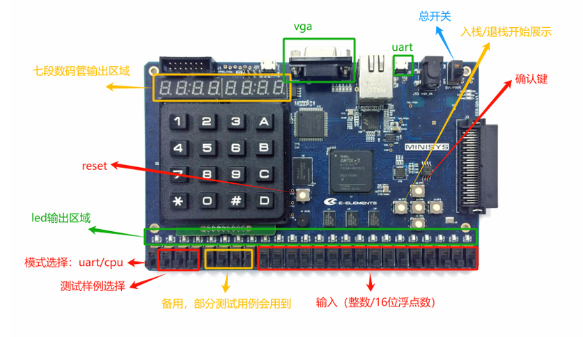
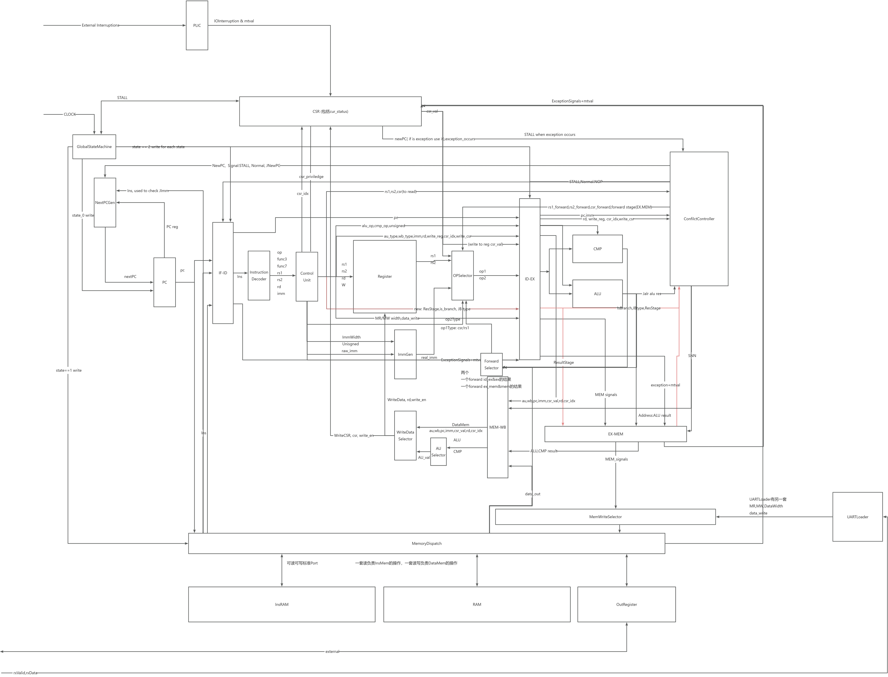

<div align="center">

# CPUdemo：五级流水 + BHT 分支预测 + CSR中断处理支持 的 RISC-V CPU 

南方科技大学 **CS202 计算机组成原理**课程项目

一颗从单周期设计逐步演进而来的 **32 位 RISC-V 五级流水线 CPU**，
搭配异常处理、外设交互、汇编程序和自建编译工具，在 Minisys FPGA 开发板上运行。

**Chisel / Scala · RISC-V · Pipeline · FPGA / Vivado · 汇编**

[项目报告](Docs/Report/计组报告.pdf) · [硬件源码](Code/hardware) · [编译工具](Code/compile_pipelines)

</div>

## 项目简介

项目从 CPU 的数据通路和控制逻辑出发，逐步实现了指令执行、流水线冒险处理、特权模式与异常处理，再将处理器与开发板外设、汇编测试程序和编译工具串联起来。硬件使用 Chisel 描述并生成 Verilog，交由 Vivado 综合、实现和部署到 FPGA。

项目报告记载：设计采用哈佛架构，指令和数据存储空间各 64 KiB；在 Minisys 开发板上的主频可达 60 MHz，所测场景平均 CPI 约为 3。性能数字来自当时的报告，依赖具体配置和测试程序。



## CPU 架构



*报告图 5：CPU 整体架构。图中展示了流水线寄存器、数据通路、冲突控制、CSR、存储器和 UART 加载等模块；点击图片可查看原始分辨率。*

系统由 **CoreTop** 和 **DeviceTop** 组成：前者负责处理器执行和存储访问，后者连接开发板外设。核心的五个阶段为取指（IF）、译码（ID）、执行（EX）、访存（MEM）和写回（WB），四组流水线寄存器在阶段之间传递数据与控制信号。

## 功能清单

- [x] **CPU 核心**
  - [x] 32 位 RISC-V 基础整数指令，包括 `LUI`、`AUIPC`、跳转、分支和访存指令
  - [x] 指令译码、立即数生成、寄存器堆、ALU 与比较器
  - [x] 指令存储器和数据存储器分离的哈佛架构
  - [x] 五级流水线及级间寄存器
- [x] **流水线控制**
  - [x] 检测数据依赖并前递结果
  - [x] 对 Load-Use 等尚不能前递的依赖暂停流水线、插入空指令
  - [x] 基于分支历史表（BHT）和状态机的动态分支预测
  - [x] 预测错误时修正 PC 并冲刷错误路径上的指令
- [x] **特权与异常**
  - [x] User / Machine 两种权限模式及权限检查
  - [x] 基本 CSR 寄存器与六条 Zicsr 指令
  - [x] 异常捕获、上下文记录及 `mret` 返回
  - [x] `ecall`、`ebreak` 的硬件支持与汇编服务程序
- [x] **外设与板上交互**
  - [x] 通过内存映射 I/O（MMIO）读写拨码开关、按钮、LED、七段数码管和 VGA
  - [x] 封装开源 UART 模块，用于初始数据加载
  - [x] 七段数码管与 VGA 数值显示
  - [x] 面向 Minisys 的时钟、复位、引脚约束与 Vivado 工程
- [x] **软件与验证**
  - [x] 两个课程测试场景的汇编程序及外设交互
  - [x] C / 汇编交叉编译、链接、机器码导出、端序转换和 COE 生成脚本
  - [x] Chisel 模块与集成测试，覆盖指令、外设、异常和流水线冲突

外设交互主要采用轮询；架构中预留了 PLIC 和外部中断相关接口，报告将外设触发中断描述为可扩展方向。

## 设计与实现

### 流水线与分支预测

项目先建立单周期 CPU 的基本结构，再加入特权和异常处理，最后改造为五级流水线。译码阶段将 RISC-V 指令映射为内部控制信号，由这些信号驱动操作数选择、运算、访存和写回；例如 `LUI` 和 `AUIPC` 复用立即数生成、操作数选择和 ALU 数据通路。

流水线让多条指令可以处于不同执行阶段，也引入指令间依赖。冲突控制模块检查源寄存器与前序指令的目标寄存器：结果已经可用时选择前递；遇到 Load-Use 等结果尚未就绪的情况，则暂停 PC 和 IF-ID，并向后插入空操作。对分支指令，处理器利用 BHT 预测下一条指令，并在实际结果不符时恢复正确 PC、冲刷错误路径。

### CSR异常处理功能支持

围绕 CSR 和 User / Machine 两种权限模式，CPU 检查敏感操作是否合法。发生异常时，硬件记录异常地址、原因和相关状态，跳转到 `mtvec` 指向的服务程序；服务程序识别 `ecall` 或 `ebreak` 等原因，完成对应处理并恢复上下文，再通过 `mret` 返回。这样，硬件负责捕获和切换，具体服务逻辑由汇编程序完成。

### 用 Chisel 描述硬件，并交付到 FPGA

硬件以 Scala / Chisel 组织，模块化描述核心、流水线控制、存储与设备；配置中区分仿真和上板所需的存储器、时钟及 UART 实现。Chisel 生成 Verilog 后，Vivado 工程再结合 IP 核、约束文件和初始化数据完成 FPGA 构建。工程也保留了外部 Verilog 模块，UART 使用的是开源实现的封装，VGA 参考了已有设计。

这一流程覆盖了从高级硬件描述到板级实现的完整路径。报告也记录了一个很实际的经验：上板行为与仿真不一致时，需要检查复位、时钟和生成的 Verilog，不能只看 Chisel 源码。

### 自建程序编译与数据转换流程

为了让程序能进入自己设计的 CPU，项目在 `riscv-none-elf` 工具链上编写了 Windows 批处理和 Python 脚本：

```text
C / RISC-V 汇编 → 预处理、编译、汇编与链接 → ELF / 二进制
                                               ↓
                            十六进制文本、端序转换、COE 初始化文件
```

其中链接脚本按项目的存储空间布局安排程序段；脚本还提供反汇编功能。由此可以将软件、CPU 存储布局和 Vivado 初始化数据连接起来，而不仅仅停留在硬件模块本身。

## 测试与结果

项目使用 Chisel / chiseltest 对模块及完整系统进行仿真，并使用汇编程序测试指令、外设与场景。报告中记录的测试结果如下：

| 测试 | 覆盖内容 | 报告记录 |
| --- | --- | --- |
| CoreTopTest | 基础指令集 | 30 / 30 通过 |
| TotalTopTest | 外设交互 | 17 / 17 通过 |
| software1Test | 汇编场景 1 | 19 / 19 通过 |
| software2Test | 汇编场景 2 | 52 / 52 通过 |
| CoreTopCSRTest | 特权模式、异常、`ecall` / `ebreak` | 4 / 4 通过 |
| otherTest | 流水线冲突 | 4 / 4 通过 |

这些是课程项目报告中的历史结果，并非本次整理时重新运行的结果。更完整的测试过程、实现细节和上板说明见[项目报告](Docs/Report/计组报告.pdf)。

## 项目结构

```text
CPUdemo_
├── Code/
│   ├── hardware/           # Chisel 源码、测试和已生成的硬件描述
│   ├── compiled_cpu/       # Vivado 工程、约束与存储器初始化文件
│   ├── compile_pipelines/  # C / 汇编交叉编译及数据转换脚本
│   ├── software/           # 汇编程序、加载和异常处理程序
│   ├── test_asm/           # 指令与场景相关的汇编测试
│   └── simulation/         # 仿真辅助脚本和波形资料
├── Docs/
│   ├── Report/             # 项目报告和架构图（演示视频仅保存在本地）
│   ├── Developing/         # 开发过程资料
│   └── Reference/          # 课程要求与参考资料
├── Publication/            # 项目展示目录
└── README.md
```

## 开发与复现

硬件工程位于 `Code/hardware`，使用 Scala 2.12.12、Chisel 3.5.4、chiseltest 0.5.4 和 sbt 1.9.7。安装 Java 与 sbt 后，可在该目录尝试 `sbt test`；`Generate.Top` 是 Verilog 生成入口。生成上板版本前，需要检查 `src/main/scala/configs/GenConfig.scala`：当前选择的是测试配置，板级配置使用 FPGA IP。

Vivado 工程位于 `Code/compiled_cpu/project_1/project_1.xpr`，并引用相邻的约束和初始化文件。重新综合需要匹配的 Vivado 环境、IP 和目标开发板；工具链脚本需要 Windows、Python、`riscv-none-elf` 工具以及脚本中调用的命令。现存工程与脚本为课程项目归档，复现过程尚未在本次整理中重新验证。

## 团队与分工

本项目由黄政东、祝超、董万希共同完成。根据项目报告：

- **黄政东**：CPU 结构、单周期与流水线设计和实现，UART、中断指令、编译工具及文档。
- **祝超**：部分 CPU 基础结构、核心及指令测试、两个汇编场景测试及文档。
- **董万希**：部分 CPU 基础结构、场景 2 汇编测试、七段数码管、VGA 及文档。

项目于 2024 年 5 月开发；从搭建 Chisel 环境、完成基础模块与测试，到异常控制、汇编程序和流水线验证，报告记录了约三周的迭代过程。

## 参考资料

项目实现与报告参考了 RISC-V 指令集手册、VGA 设计资料、Alex Forencich 的开源 UART 和 xPack RISC-V 工具链；详见[项目报告参考文献](Docs/Report/计组报告.pdf)。

## 碎碎念

- chisel真好用XD，比verilog好写多了（ai也这么觉得的——所以即便是vibe coding era也要让ai写chisel XD）
- 啊！当年还是纯手写没有任何AI……
- 理解硬件开发的并行性和时序电路的基本逻辑（时序更新）非常重要，分清楚 存储部分 和 组合逻辑部分
- 项目基本上是先支持基础指令跑通，再抽离加入五级流水，特殊指令（ecall, ebreak实现），CSR异常处理实现，分支预测等硬件模块
- 良好的开发pipeline能极大提高开发效率和质量，充分的本地仿真对拍测试显著降低了真实上板的debug耗时。即便是ai era，构建良好的测试支持依旧是非常重要的
- 汇编代码不好写，建议如果手写，要构建一个C工具链比较健康
- 模块化开发是关键，项目中的组合逻辑很多都抽离成模块了，为后续改造提供了很大支持
- 十分感谢两位队友：祝超 和 董万希 在项目中的全力投入！


---

<div align="center">

# CPUdemo: A RISC-V CPU with a Five-Stage Pipeline, BHT Branch Prediction, and CSR Interrupt Handling

A course project for **CS202 Computer Organization** at Southern University of Science and Technology

A **32-bit, five-stage pipelined RISC-V CPU**, developed from an initial single-cycle design and brought to life on a Minisys FPGA board with exception handling, peripherals, assembly programs, and a custom compilation workflow.

**Chisel / Scala · RISC-V · Pipeline · FPGA / Vivado · Assembly**

[Project report](Docs/Report/计组报告.pdf) · [Hardware source](Code/hardware) · [Compilation tools](Code/compile_pipelines)

</div>

## Project Introduction

Starting with the CPU datapath and control logic, the project gradually added instruction execution, pipeline hazard handling, privilege modes, and exception handling. The processor was then integrated with board peripherals, assembly test programs, and compilation tools. The hardware is described in Chisel, generated as Verilog, and passed to Vivado for synthesis, implementation, and FPGA deployment.

The project report describes a Harvard architecture with 64 KiB each for instruction and data memory. It records a clock frequency of up to 60 MHz on the Minisys board and an average CPI of approximately 3 for the tested scenarios. These figures are from the original report and depend on the configuration and test programs.


## CPU Architecture


*Figure 5 from the report: the overall CPU architecture, including pipeline registers, datapath, hazard control, CSRs, memory, and UART loading. Click the image to view it at its original resolution.*

The system consists of **CoreTop** and **DeviceTop**: the former handles processor execution and memory access, while the latter connects the board peripherals. The core has five stages: instruction fetch (IF), decode (ID), execute (EX), memory access (MEM), and write-back (WB). Four sets of pipeline registers carry data and control signals between stages.

## Feature Checklist

- [x] **CPU core**
  - [x] 32-bit RISC-V base integer instructions, including `LUI`, `AUIPC`, jumps, branches, and memory access instructions
  - [x] Instruction decoding, immediate generation, register file, ALU, and comparator
  - [x] Harvard architecture with separate instruction and data memories
  - [x] Five-stage pipeline and interstage registers
- [x] **Pipeline control**
  - [x] Data dependency detection and result forwarding
  - [x] Pipeline stalls and inserted no-ops for dependencies such as load-use hazards when forwarding is not yet possible
  - [x] Dynamic branch prediction using a branch history table (BHT) and state machines
  - [x] PC correction and flushing of instructions on the wrong path after a misprediction
- [x] **Privilege and exceptions**
  - [x] User and Machine privilege modes with privilege checks
  - [x] Basic control and status registers (CSRs) and the six Zicsr instructions
  - [x] Exception capture, context recording, and return with `mret`
  - [x] Hardware support and assembly service routines for `ecall` and `ebreak`
- [x] **Peripherals and board interaction**
  - [x] Memory-mapped I/O (MMIO) for switches, buttons, LEDs, seven-segment displays, and VGA
  - [x] Wrapper around an open-source UART module for initial data loading
  - [x] Numeric output on the seven-segment display and VGA
  - [x] Minisys clock, reset, pin constraints, and Vivado project
- [x] **Software and verification**
  - [x] Assembly programs and peripheral interaction for two course test scenarios
  - [x] Scripts for C / assembly cross-compilation, linking, machine-code export, endianness conversion, and COE generation
  - [x] Chisel module and integration tests covering instructions, peripherals, exceptions, and pipeline hazards

Peripheral interaction primarily uses polling. The architecture reserves PLIC and external-interrupt interfaces; the report describes peripheral-triggered interrupts as an extension point.

## Design and Implementation

### Pipeline and Branch Prediction

The project began with the basic structure of a single-cycle CPU, then added privilege and exception handling before being converted to a five-stage pipeline. The decode stage maps RISC-V instructions to internal control signals that drive operand selection, execution, memory access, and write-back. For example, `LUI` and `AUIPC` reuse the immediate generator, operand selectors, and ALU datapath.

Pipelining allows multiple instructions to occupy different execution stages, but also introduces dependencies between them. The hazard controller compares source registers with destination registers of earlier instructions: when a result is available, it is forwarded; for cases such as load-use hazards, where the result is not ready, the PC and IF-ID register are stalled and a no-op is inserted. For branch instructions, the processor uses a BHT to predict the next instruction, then restores the correct PC and flushes the wrong path if the prediction is incorrect.

### CSR and Exception Handling

Using CSRs and the User / Machine privilege modes, the CPU checks whether sensitive operations are legal. When an exception occurs, hardware records the exception address, cause, and relevant state, then transfers control to the service routine pointed to by `mtvec`. The routine identifies causes such as `ecall` or `ebreak`, performs the appropriate service, restores the context, and returns with `mret`. Hardware handles capture and control transfer, while the service logic is implemented in assembly.

### Describing Hardware in Chisel and Deploying to FPGA

The hardware is organized in Scala / Chisel, with modules for the core, pipeline control, memory, and devices. Configuration options distinguish the memory, clock, and UART implementations used for simulation and on-board operation. Chisel generates Verilog, which the Vivado project combines with IP cores, constraints, and initialization data to build the FPGA design. The project also includes external Verilog modules: UART wraps an open-source implementation, and VGA draws on an existing design.

This workflow covers the path from a high-level hardware description to a board implementation. The report also records a practical lesson: when board behavior differs from simulation, inspect reset, clocks, and the generated Verilog as well as the Chisel source.

### Custom Program Compilation and Data Conversion

To run programs on the CPU, the project adds Windows batch and Python scripts around the `riscv-none-elf` toolchain:

```text
C / RISC-V assembly → preprocessing, compilation, assembly, and linking → ELF / binary
                                                                              ↓
                                    hexadecimal text, endianness conversion, COE files
```

The linker script places program sections according to the project's memory layout; the scripts also support disassembly. This connects the software, CPU memory layout, and Vivado initialization data into one workflow.

## Tests and Results

The project uses Chisel / chiseltest to simulate individual modules and the complete system, together with assembly programs to test instructions, peripherals, and scenarios. The original report records the following results:

| Test | Coverage | Reported result |
| --- | --- | --- |
| CoreTopTest | Base instruction set | 30 / 30 passed |
| TotalTopTest | Peripheral interaction | 17 / 17 passed |
| software1Test | Assembly scenario 1 | 19 / 19 passed |
| software2Test | Assembly scenario 2 | 52 / 52 passed |
| CoreTopCSRTest | Privilege modes, exceptions, `ecall` / `ebreak` | 4 / 4 passed |
| otherTest | Pipeline hazards | 4 / 4 passed |

These are historical results from the course project report, not tests rerun during this archival cleanup. See the [project report](Docs/Report/计组报告.pdf) for the full testing process, implementation details, and board instructions.

## Project Structure

```text
CPUdemo_
├── Code/
│   ├── hardware/           # Chisel source, tests, and generated hardware descriptions
│   ├── compiled_cpu/       # Vivado project, constraints, and memory initialization files
│   ├── compile_pipelines/  # C / assembly cross-compilation and conversion scripts
│   ├── software/           # Assembly programs, loader, and exception handlers
│   ├── test_asm/           # Instruction and scenario assembly tests
│   └── simulation/         # Simulation scripts and waveform materials
├── Docs/
│   ├── Report/             # Project report and architecture diagram (demo video is local only)
│   ├── Developing/         # Development materials
│   └── Reference/          # Course requirements and references
├── Publication/            # Project presentation directory
└── README.md
```

## Development and Reproduction

The hardware project is in `Code/hardware` and uses Scala 2.12.12, Chisel 3.5.4, chiseltest 0.5.4, and sbt 1.9.7. With Java and sbt installed, try `sbt test` in that directory; `Generate.Top` is the Verilog generation entry point. Before generating a board version, check `src/main/scala/configs/GenConfig.scala`: the current selection is the test configuration, while the board configuration uses FPGA IP.

The Vivado project is at `Code/compiled_cpu/project_1/project_1.xpr` and references adjacent constraint and initialization files. Rebuilding requires a compatible Vivado environment, IP, and target board. The toolchain scripts require Windows, Python, `riscv-none-elf`, and the commands invoked by the scripts. The project and scripts are archived course materials; the reproduction process has not been revalidated during this cleanup.

## Team and Contributions

The project was completed by Zhengdong Huang (黄政东), Chao Zhu (祝超), and Wanxi Dong (董万希). According to the project report:

- **Zhengdong Huang**: CPU architecture, single-cycle and pipeline design and implementation, UART, interrupt-related instructions, compilation tools, and documentation.
- **Chao Zhu**: parts of the basic CPU structure, core and instruction tests, assembly tests for both scenarios, and documentation.
- **Wanxi Dong**: parts of the basic CPU structure, assembly tests for scenario 2, seven-segment display, VGA, and documentation.

The project was developed in May 2024. The report records approximately three weeks of iteration, from setting up Chisel and completing the basic modules and tests through exception control, assembly programs, and pipeline verification.

## References

The implementation and report draw on the RISC-V instruction set manuals, VGA design materials, Alex Forencich's open-source UART, and the xPack RISC-V toolchain. See the references in the [project report](Docs/Report/计组报告.pdf).

## A Few Thoughts

- Chisel is really nice to use XD. It is much more pleasant to write than Verilog (AI seems to think so too — even in the vibe-coding era, have AI write Chisel XD).
- Ah! Back then, everything was handwritten without any AI...
- Understanding concurrency in hardware development and the basic logic of sequential circuits (state updates) is essential. Keep the storage elements and combinational logic distinct.
- The project broadly started by getting the basic instructions working, then refactored the design to add a five-stage pipeline, special instructions (`ecall` and `ebreak`), CSR exception handling, branch prediction, and other hardware modules.
- A good development pipeline can greatly improve efficiency and quality. Thorough local simulation and comparison testing significantly reduce debugging time on the real board. Even in the AI era, strong test support remains essential.
- Assembly is hard to write. If you are writing it by hand, having a C toolchain is a healthier option.
- Modular development is key. Much of the project's combinational logic was extracted into modules, which made later changes much easier.
- Many thanks to my teammates, Chao Zhu and Wanxi Dong, for giving their all to the project!
